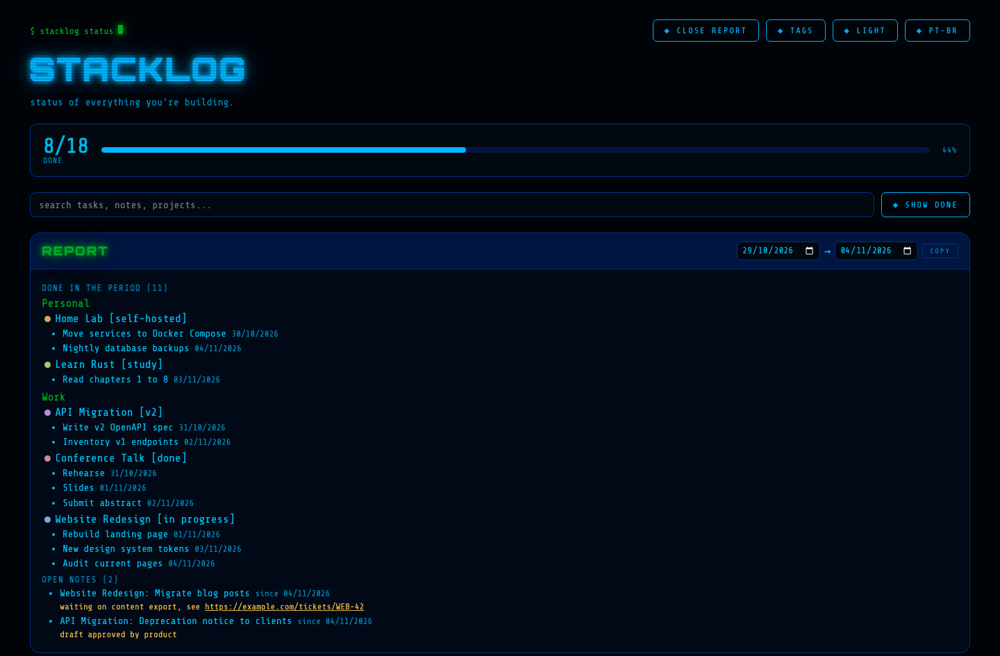

# Stacklog

A self-hosted backlog tracker for personal projects. Create as many projects
as you want, give each one a color, a tag and a link, and keep a simple
checklist of what is done and what is still pending. One container, Flask +
SQLite, no account, no cloud, no external dependency.


## Why

Side projects pile up fast and it is easy to lose track of what is actually
left to do on each one. Stacklog is a single page that shows every project
side by side, with a progress bar per project and one for everything
combined, so a quick glance tells you where things stand. A built-in report
answers "what did I get done this week?" without any extra bookkeeping.

## Features

**Projects and categories**
- Create, rename, and delete projects from the page itself, no config file
  editing required
- Pick an accent color per project from a built-in palette
- Tag each project from a shared tag list, with autocomplete, so the same
  tag is never spelled two ways
- Attach a link to a project (a ticket, a repo, a doc) and open it with one
  click from the card
- Group projects into user-created categories, drag and drop a project card
  onto another category to move it
- Collapse and expand project cards, drag a card's handle to reorder it
  within a category, drag a category's handle to reorder categories
- Archive finished projects: they leave the board but stay searchable and
  keep showing up in the report

**Tasks**
- Add, check off, and delete tasks per project
- Edit a task's title and notes in place
- Notes on any task, with URLs turned into clickable links
- Done tasks are tucked into a collapsible "done (n)" group per project,
  each one showing the day it was finished
- Drag tasks to reorder them
- Deleting a task can be undone for a few seconds

**Overview**
- Search across task titles, notes, project names and tags
- Overall, per-category and per-project progress bars
- Report of everything finished in a date range (last 7 days by default),
  grouped by category and project, plus the open tasks that have notes,
  with a one-click copy as plain text



**Everything else**
- Drag and drop works with mouse and touch, so it also works on a phone
- Layout fits the screen: as many card columns as fit on wide monitors,
  down to one column on a phone, with finger-sized controls on touch
  screens
- Four themes: dark, light, amber phosphor and green phosphor, picked
  from a list; "automatic" (the default) follows the system's dark or
  light setting
- Portuguese and English UI, picked from a list; "automatic" (the
  default) follows the browser's language, falling back to English for
  any other language
- Data persists in SQLite, a single file you can back up or copy, with a
  ready-made daily backup script
- JSON API for every action, including creating a project with all its
  tasks in one call
- Ships with a demo project so the page is never empty on first run

## Quick start

```bash
git clone https://github.com/juliomauro/stacklog.git
cd stacklog
docker compose up --build
```

Open `http://localhost:4100`.

That's it. No signup, no environment variables required, no external
service.

## Deploying

### Plain Docker Compose (any VPS, home server, or local machine)

The `docker-compose.yml` in this repo builds the image from the local
`app/` folder:

```bash
docker compose up -d --build
```

The app listens on port `4100` by default. Change the left side of the port
mapping in `docker-compose.yml` to use a different host port.

### Pre-built image

A pre-built image is published to GitHub Container Registry, so you do not
have to build it yourself:

```yaml
services:
  stacklog:
    image: ghcr.io/juliomauro/stacklog:latest
    container_name: stacklog
    restart: unless-stopped
    ports:
      - "4100:8080"
    volumes:
      - stacklog_data:/data

volumes:
  stacklog_data:
```

### CasaOS / ZimaOS

CasaOS-based systems (ZimaOS, ZimaCube, plain CasaOS) manage apps through
their own App Management service, which installs from a compose file and
always pulls the image from a registry, even when a matching image already
exists locally. Because of that, a `build:` directive does not work with
CasaOS's install flow: use the pre-built image compose file above instead.

1. Copy the compose file above into a `.yml` file.
2. In the CasaOS/ZimaOS dashboard, use "Install a customized app" (or
   whatever your version calls pasting a compose file) and paste it in.
3. Or, from the command line, if your box ships `casaos-cli`:
   ```bash
   casaos-cli app-management install -f stacklog.yml
   ```
4. The app should appear in your dashboard as `backlog-projects`, matching
   the `name:` field in the compose file.

The image includes a `HEALTHCHECK`, which CasaOS/ZimaOS uses to confirm the
app started correctly and to show the right status in the dashboard.

### Reverse proxy / remote access

Stacklog has no authentication built in. If you expose it outside your own
network, put it behind a reverse proxy with authentication (for example
Authelia, Authentik, or your proxy's own basic auth), or keep it reachable
only over a private network or VPN (Tailscale, WireGuard).

## Using Stacklog

**Top of the page**
- **Report, tags, theme and language**: the `◈` buttons at the top right.
  "Tema" / "theme" and "idioma" / "language" open a list to pick from
  (arrow keys move, Enter picks, Esc closes). The choice is remembered in
  the browser; "automatic" follows your system's color scheme and your
  browser's language (English for any language other than Portuguese).
- **Search**: type in the box under the progress bar. Matching projects
  open by themselves, categories with no match are hidden, archived
  projects that match show up too. Press Esc to clear.
- **Show/hide done**: the button next to the search box opens or closes
  the "done" group of every project at once.

**Categories and projects**
- **New category**: open "+ Nova categoria" / "+ New category" at the
  bottom of the page and give it a name. Projects with no category land in
  an always-available "Sem categoria" / "Uncategorized" bucket.
- **New project**: each category has its own "+ novo projeto" trigger;
  pick a name, an optional tag (with autocomplete), and an accent color.
- **Rename**: double-click a project's name or a category's heading to
  edit it in place. Press Enter or click away to save.
- **Tag**: double-click a project's tag to change it. The field
  autocompletes from the tag list; typing a tag that does not exist yet
  asks before creating it, and a different capitalization of an existing
  tag is saved with the list's spelling.
- **Link**: click the 🔗 button on a card to add a link. Once set, the card
  shows a chip with the end of the address (Ex: `🔗 WEB-12`): click it to
  open the link in a new tab, double-click it to edit or clear it. A link
  typed without `https://` gets it added.
- **Archive**: click ⤓ on a card to archive the project. The button is
  highlighted when every task is done. Archived projects move to the
  collapsed "Arquivados" / "Archived" section at the bottom, are left out
  of the overall progress bar, and still appear in search and in the
  report. Click ⤒ to bring one back.
- **Reorder or move a project**: drag a project card by its handle (⠿) to
  reorder it within a category, or drop it onto a different category's
  section to move it there. Works with a finger on touch screens too.
- **Reorder categories**: drag a category by the handle (⠿) next to its
  name. While dragging, every category shows only its header so the list
  fits on screen; a line marks where it will land.
- **Delete**: the small "x" next to a category's heading deletes it (its
  projects become uncategorized, they are not deleted). The "x" on a
  project card deletes the project and all of its tasks. Both ask for
  confirmation.
- **Collapse/expand**: click a project card's header to collapse it to
  just the progress bar, or expand it back. This is remembered per
  project in your browser.

**Tasks**
- **Add**: type into the input at the bottom of a project's card and
  press Enter, or click "adicionar" / "add".
- **Check off**: click the checkbox, or click the task's text. Done tasks
  move into the "concluídas (n)" / "done (n)" group at the end of the
  card, which opens with a click; each shows the day it was finished.
- **Edit and notes**: click ✎ or double-click the task's text to edit the
  title and the notes in place. Enter in the title saves, Ctrl+Enter saves
  from the notes, Esc cancels. Notes show under the title, and any
  `http(s)://` address in them becomes a link.
- **Reorder**: drag an open task by its handle (⠿) within its project.
- **Delete**: click the "x" next to a task. A message at the bottom of the
  page offers "desfazer" / "undo" for a few seconds before the task is
  really deleted.

**Report**
- Click "◈ relatório" / "◈ report" to open it. It lists every task
  finished between the two dates (last 7 days by default), grouped by
  category and project with the finish date, followed by the open tasks
  that have notes. "Copiar" / "copy" puts the same content on the
  clipboard as plain text, ready to paste into a status update.

**Tags**
- Click "◈ tags" to manage the tag list. Each tag shows how many projects
  use it; click the count to search for those projects.
- Edit a tag's name and press Enter to rename it everywhere. Renaming a
  tag to the name of another existing tag merges the two, after a
  confirmation.
- The "x" deletes a tag; the projects that used it are left without one.
- The first time this version runs, the list is filled from the tags your
  projects already use.

**Demo project**
- The first time Stacklog runs with an empty database it seeds one
  example project with three placeholder tasks, so the page is never
  blank. Delete it whenever you want.

## Data and backups

Everything lives in a single SQLite file at `/data/stacklog.db` inside the
container, on the `stacklog_data` volume (or a bind mount if your platform
converts named volumes, as CasaOS does). Back up that one file and you have
your entire backlog. The schema is created and upgraded automatically on
start: new columns and tables are added in place and existing data is kept,
no migration step is required.

For a one-off copy:

```bash
docker cp stacklog:/data/stacklog.db ./stacklog-backup.db
```

For daily backups, use [`scripts/backup.sh`](scripts/backup.sh) on the
Docker host. It takes a consistent SQLite snapshot inside the running
container (safe while the app is in use), checks its integrity, copies it
out of the volume and keeps the newest 7 copies. The container name, the
backup folder and the number of copies kept can be changed with the
`CONTAINER`, `BACKUP_DIR` and `KEEP` environment variables.

```bash
# run it once by hand
BACKUP_DIR=/srv/backups/stacklog ./scripts/backup.sh

# or schedule it, Ex: every day at 03:00 (crontab -e)
0 3 * * * /path/to/backup.sh >> /srv/backups/stacklog/cron.log 2>&1
```

## API

All endpoints are plain JSON over HTTP, no authentication. Times are Unix
epoch milliseconds.

**Categories**

| Method | Path | Body | Description |
|---|---|---|---|
| GET | `/api/categories` | | List all categories |
| POST | `/api/categories` | `{name}` | Create a category |
| PATCH | `/api/categories/<id>` | `{name?, order_index?}` | Update a category |
| DELETE | `/api/categories/<id>` | | Delete a category, uncategorizing its projects |

**Projects**

| Method | Path | Body | Description |
|---|---|---|---|
| GET | `/api/projects` | | List all projects, archived ones included (`archived_at` is set) |
| POST | `/api/projects` | `{name, color?, tag?, link?, category_id?, tasks?}` | Create a project; `tasks` is an optional list of titles or `{title, done?, note?}` objects created with it |
| PATCH | `/api/projects/<id>` | `{name?, color?, tag?, link?, archived?, order_index?, category_id?}` | Update a project; `archived: true/false` archives or restores it |
| DELETE | `/api/projects/<id>` | | Delete a project and its tasks |

A tag sent with a project is matched against the tag list ignoring case
and stored with the list's spelling; a new tag is added to the list.

**Tasks**

| Method | Path | Body | Description |
|---|---|---|---|
| GET | `/api/tasks?project_id=` | | List tasks, all of them or one project's, in their manual order |
| POST | `/api/tasks` | `{project_id, title, done?, note?}` | Create a task |
| PATCH | `/api/tasks/<id>` | `{done?, title?, note?}` | Update a task; checking it records `done_at`, unchecking clears it |
| POST | `/api/tasks/reorder` | `{ids: [...]}` | Set the order of a project's tasks to the order of `ids` |
| DELETE | `/api/tasks/<id>` | | Delete a task |

**Tags**

| Method | Path | Body | Description |
|---|---|---|---|
| GET | `/api/tags` | | List tags with the number of projects using each |
| POST | `/api/tags` | `{name}` | Create a tag (409 if it exists, ignoring case) |
| PATCH | `/api/tags/<id>` | `{name}` | Rename a tag everywhere; using another tag's name merges them |
| DELETE | `/api/tags/<id>` | | Delete a tag, clearing it from its projects |

**Report**

| Method | Path | Description |
|---|---|---|
| GET | `/api/report?since=YYYY-MM-DD&until=YYYY-MM-DD` | Tasks finished in the range (both days included, default last 7 days), grouped by category and project, plus the open tasks that have notes |

Example, creating a project with its tasks in one call:

```bash
curl -s -X POST http://localhost:4100/api/projects \
  -H 'Content-Type: application/json' \
  -d '{"name": "Home Lab", "tag": "self-hosted", "link": "https://github.com/me/homelab",
       "tasks": [{"title": "Move services to Compose", "done": true},
                 {"title": "Nightly backups", "note": "see scripts/backup.sh"},
                 "Reverse proxy with local DNS"]}'
```

## Tech stack

- Backend: Python, Flask, SQLite (stdlib `sqlite3`), served by Gunicorn
- Frontend: a single HTML file, no build step, no framework
- Image: `python:3.12-alpine`, around 64 MB

## Development

```bash
cd app
pip install -r requirements.txt
python server.py
```

The dev server listens on `http://localhost:8080` and stores its database
at `/data/stacklog.db` by default; set `DB_PATH` to point somewhere else
when running outside a container.

## Contributing

Issues and pull requests are welcome. This is a small, intentionally
simple tool: before adding a feature, consider whether it still fits on
one page with no configuration.

## License

MIT, see [LICENSE](LICENSE).
