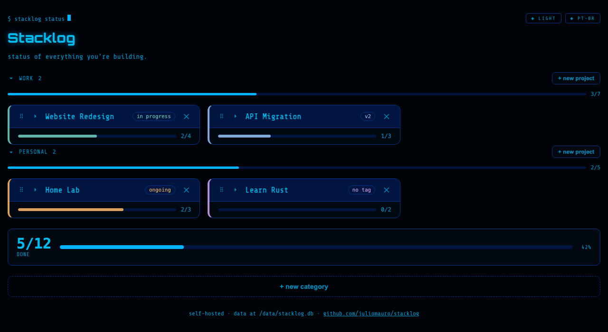

# Stacklog

A self-hosted backlog tracker for personal projects. Create as many projects
as you want, give each one a color and a tag, and keep a simple checklist of
what is done and what is still pending. One container, Flask + SQLite, no
account, no cloud, no external dependency.




## Why

Side projects pile up fast and it is easy to lose track of what is actually
left to do on each one. Stacklog is a single page that shows every project
side by side, with a progress bar per project and one for everything
combined, so a quick glance tells you where things stand.

## Features

- Create, rename, and delete projects from the page itself, no config file
  editing required
- Pick an accent color per project from a built-in palette
- Add an optional tag per project (for example "alpha", "in production",
  "firmware")
- Group projects into user-created categories, drag and drop a project card
  onto another category to move it
- Collapse and expand project cards, drag a card's handle to reorder it
  within a category
- Add, check off, and delete tasks per project
- Overall and per-category and per-project progress bars
- Data persists in SQLite, a single file you can back up or copy
- Dark and light theme, follows the system setting by default, with a
  toggle button to override it
- Portuguese and English UI, detected from the browser's language, with
  a toggle button to override it (falls back to English for any other
  language)
- Ships with a demo project so the page is never empty on first run

## Quick start

```bash
git clone https://github.com/juliomauro/stacklog.git
cd stacklog
docker compose up --build
```

Open `http://localhost:4100`.

That's it. No signup, no environment variables required, no external
service.

## Deploying

### Plain Docker Compose (any VPS, home server, or local machine)

The `docker-compose.yml` in this repo builds the image from the local
`app/` folder:

```bash
docker compose up -d --build
```

The app listens on port `4100` by default. Change the left side of the port
mapping in `docker-compose.yml` to use a different host port.

### Pre-built image

A pre-built image is published to GitHub Container Registry, so you do not
have to build it yourself:

```yaml
services:
  stacklog:
    image: ghcr.io/juliomauro/stacklog:latest
    container_name: stacklog
    restart: unless-stopped
    ports:
      - "4100:8080"
    volumes:
      - stacklog_data:/data

volumes:
  stacklog_data:
```

### CasaOS / ZimaOS

CasaOS-based systems (ZimaOS, ZimaCube, plain CasaOS) manage apps through
their own App Management service, which installs from a compose file and
always pulls the image from a registry, even when a matching image already
exists locally. Because of that, a `build:` directive does not work with
CasaOS's install flow: use the pre-built image compose file above instead.

1. Copy the compose file above into a `.yml` file.
2. In the CasaOS/ZimaOS dashboard, use "Install a customized app" (or
   whatever your version calls pasting a compose file) and paste it in.
3. Or, from the command line, if your box ships `casaos-cli`:
   ```bash
   casaos-cli app-management install -f stacklog.yml
   ```
4. The app should appear in your dashboard as `backlog-projects`, matching
   the `name:` field in the compose file.

The image includes a `HEALTHCHECK`, which CasaOS/ZimaOS uses to confirm the
app started correctly and to show the right status in the dashboard.

### Reverse proxy / remote access

Stacklog has no authentication built in. If you expose it outside your own
network, put it behind a reverse proxy with authentication (for example
Authelia, Authentik, or your proxy's own basic auth), or keep it reachable
only over a private network or VPN (Tailscale, WireGuard).

## Using Stacklog

- **Theme and language**: the two `◈` buttons at the top right switch
  between dark/light theme and Portuguese/English. Your choice is
  remembered in the browser; until you click them, Stacklog follows your
  system's color scheme and your browser's language (English for any
  language other than Portuguese).
- **New category**: open "+ Nova categoria" / "+ New category" at the
  bottom of the page and give it a name. Projects with no category land in
  an always-available "Sem categoria" / "Uncategorized" bucket.
- **New project**: each category has its own "+ novo projeto" trigger;
  pick a name, an optional tag, and an accent color.
- **Rename**: double-click a project's name or tag, or a category's
  heading, to edit it in place. Press Enter or click away to save.
- **Reorder or move a project**: drag a project card by its handle (⠿) to
  reorder it within a category, or drop it onto a different category's
  section to move it there.
- **Delete a category**: click the small "x" next to its heading. Its
  projects become uncategorized, they are not deleted. You will be asked
  to confirm.
- **Delete a project**: click the small "x" next to the project's tag.
  This also deletes all of its tasks. You will be asked to confirm.
- **Collapse/expand**: click a project card's header to collapse it to
  just the progress bar, or expand it back. This is remembered per
  project in your browser.
- **Tasks**: type into the input at the bottom of a project's card and
  press Enter, or click "adicionar" / "add". Click a checkbox to mark a
  task done, click the "x" next to a task to remove it.
- **Demo project**: the first time Stacklog runs with an empty database it
  seeds one example project with three placeholder tasks, so the page is
  never blank. Delete it whenever you want.

## Data and backups

Everything lives in a single SQLite file at `/data/stacklog.db` inside the
container, on the `stacklog_data` volume (or a bind mount if your platform
converts named volumes, as CasaOS does). Back up that one file and you have
your entire backlog. The database schema is created automatically on first
run, no migration step is required.

```bash
# copy the database out of a running container
docker cp stacklog:/data/stacklog.db ./stacklog-backup.db
```

## API

All endpoints are plain JSON over HTTP, no authentication.

| Method | Path | Body | Description |
|---|---|---|---|
| GET | `/api/categories` | | List all categories |
| POST | `/api/categories` | `{name}` | Create a category |
| PATCH | `/api/categories/<id>` | `{name?, order_index?}` | Update a category |
| DELETE | `/api/categories/<id>` | | Delete a category, uncategorizing its projects |
| GET | `/api/projects` | | List all projects |
| POST | `/api/projects` | `{name, color, tag, category_id?}` | Create a project |
| PATCH | `/api/projects/<id>` | `{name?, color?, tag?, order_index?, category_id?}` | Update a project |
| DELETE | `/api/projects/<id>` | | Delete a project and its tasks |
| GET | `/api/tasks` | | List all tasks |
| POST | `/api/tasks` | `{project_id, title}` | Create a task |
| PATCH | `/api/tasks/<id>` | `{done}` | Mark a task done or not done |
| DELETE | `/api/tasks/<id>` | | Delete a task |

## Tech stack

- Backend: Python, Flask, SQLite (stdlib `sqlite3`), served by Gunicorn
- Frontend: a single HTML file, no build step, no framework
- Image: `python:3.12-alpine`, around 64 MB

## Development

```bash
cd app
pip install -r requirements.txt
python server.py
```

The dev server listens on `http://localhost:8080` and stores its database
at `/data/stacklog.db` by default; set `DB_PATH` to point somewhere else
when running outside a container.

## Contributing

Issues and pull requests are welcome. This is a small, intentionally
simple tool: before adding a feature, consider whether it still fits on
one page with no configuration.

## License

MIT, see [LICENSE](LICENSE).
